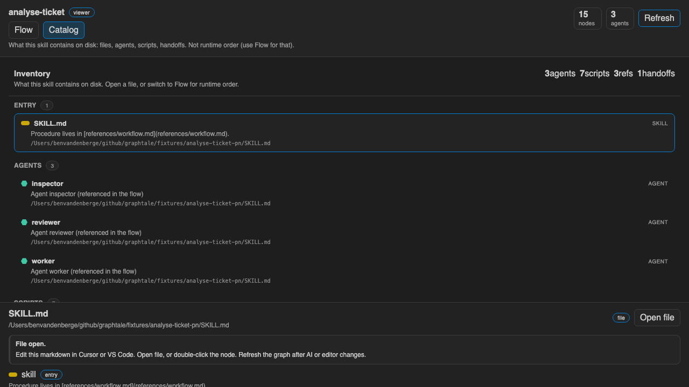
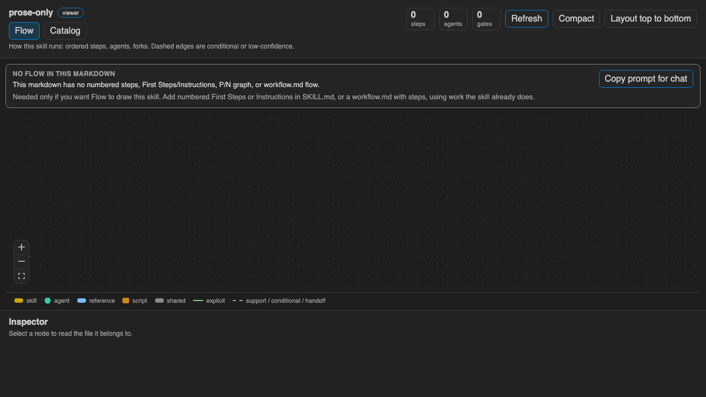

<p>
  <a href="https://pesuto.dev/">a pesuto tool</a>
</p>

# Graphtale

See the intended runtime of an Agent Skill from the SKILL.md you already
wrote, without changing the files.

Cursor / VS Code extension. Apache-2.0; the Pesuto and Graphtale names
are not (see [NOTICE](NOTICE) and [TRADEMARK.md](TRADEMARK.md)).

## Screenshots

Flow view (golden fixture):


Catalog inventory:



Honest diagnosis when no flow is found:



## What it does

Opens a skill folder and shows two views:

- **Flow**: the ordered steps the skill says to run, with how sure that
  reconstruction is. If there is no flow in the text, the view stays empty
  and says so. This is the first tab, and the view that opens with the skill.
- **Catalog**: files and references that belong to the skill (not runtime order).

Double-click a node or use **Open file** to edit markdown in the editor. When
those files change, **Refresh** lights up. The graph never writes the flow or
modifies skill files.

This is not a skill installer, flow editor, or session debugger.

## Flow detection

High confidence when the skill has a P/N ASCII graph, numbered workflow
headings, **First Steps** / **Instructions** (numbered), or `operations.md`.
Prose-only marketplace skills get an honest “none” diagnosis. The banner
says when a chat prompt is needed (only if you want Flow to draw the
skill) and copies a prompt that asks for numbered First Steps without
inventing new work.

Skill roots: [docs/skill-locations.md](docs/skill-locations.md). Codex
canonical user path is `~/.codex/skills`. Optional `agents/openai.yaml` is
listed in Catalog when present.

## Develop

```bash
npm install
npm test
npm run check
npm run validate
npm run compile
```

**Run Extension** (`F5`). Then:

- Command Palette → **Graphtale: Open Agent Skill Flow** (picks a skill
  if more than one is found)
- Activity bar **Graphtale** → click a skill (or the Open icon)
- Editor title / explorer context on a `SKILL.md` file

Browser preview (no Extension Host):

```bash
npm run preview
```

Package a marketplace `.vsix` (publisher `pesuto`, package `graphtale`):

```bash
npm run package
```

Regenerate marketplace screenshots:

```bash
npm run screenshots
```

See [CHANGELOG.md](CHANGELOG.md).

## Roadmap

See [PLAN.md](PLAN.md). Flow editor stays parked.
