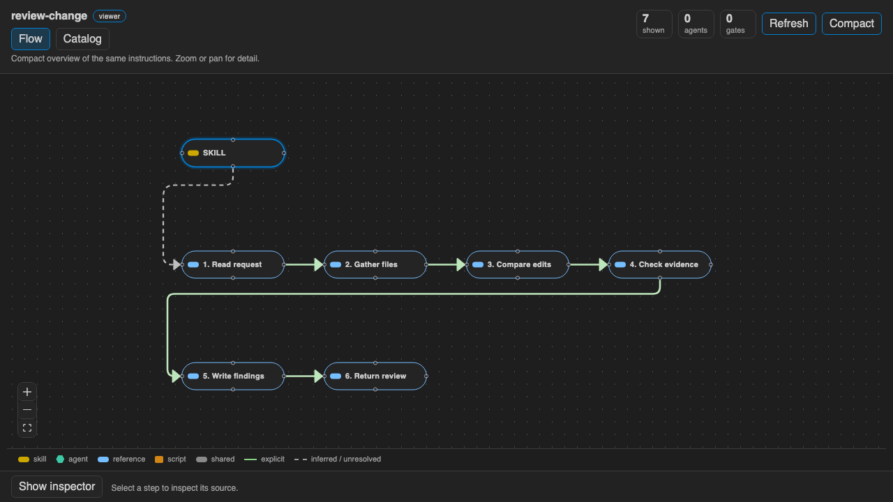

[](https://github.com/pesuto-dev/graphtale/actions/workflows/ci.yml)
[](LICENSE)
[](https://code.visualstudio.com/)

<p><a href="https://pesuto.dev/">a pesuto tool</a></p>

# Graphtale

Graphtale is a read-only Cursor and VS Code extension for visual review of an
Agent Skill from the files you already wrote. It shows supported instruction
structure and the files a skill refers to. It does not edit, install, or
execute the skill, and it does not call a backend.

## Install

Install Graphtale from the [Visual Studio Marketplace](https://marketplace.visualstudio.com/items?itemName=pesuto.graphtale).
In VS Code, open Extensions and search for `graphtale`, or run:

```bash
code --install-extension pesuto.graphtale
```

Install it from [Open VSX](https://open-vsx.org/extension/pesuto/graphtale) as well.
You can also download the `.vsix` attached to the
[GitHub release](https://github.com/pesuto-dev/graphtale/releases) and install it
with **Extensions: Install from VSIX...**.

The package targets VS Code `^1.125.0` and compatible Cursor builds. Graphtale is not an npm library: do not
`import` it. Details are in [docs/install.md](docs/install.md).

## Usage

Open a folder that contains a skill and run **Graphtale: Open Agent Skill Flow**
from the Command Palette. If several skills are found, pick one. Flow opens
first. Catalog lists the skill’s files.

Paste this skill into `.cursor/skills/review-change/SKILL.md` (the same layout
works under `.claude/skills`, `.codex/skills`, or `.agents/skills`):

```markdown
---
name: review-change
description: Review a change using its source evidence.
---

## Instructions
1. Read request
2. Gather files
3. Compare edits
4. Check evidence
5. Write findings
6. Return review
```

Open that `SKILL.md` and choose **Open Agent Skill Flow**. The six numbered
instructions become six source-linked steps. Select a step and choose **Open
instruction** to jump to the source line. **Refresh** after you edit the file.
The viewer never writes the skill.



Supported locations are listed in [docs/skill-locations.md](docs/skill-locations.md).

## Commands and views

These contributed commands are the public interface:

| Command | Title | Where it appears |
| --- | --- | --- |
| `graphtale.openViewer` | Open Agent Skill Flow | Command Palette, `SKILL.md` editor title, explorer context menu |
| `graphtale.refresh` | Refresh open skill | Command Palette |
| `graphtale.refreshTree` | Refresh Skills | Command Palette and the Skills view title |

The activity bar container **Graphtale** has one view, **Skills**
(`graphtale.skills`). It lists discovered skills. Opening one shows the webview.

Inside the webview:

- **Flow** is the supported instruction graph. **Compact** packs that same graph into wrapped rows. Outside Compact, **Layout** switches between top-to-bottom and left-to-right. Nodes are not draggable and edges are not editable.
- **Catalog** is a grouped file inventory. It does not imply execution order.
- The inspector shows the selected step’s source text. **Open instruction** (or **Open file** when the node has no instruction range) and **Open referenced resource** open the editor. Double-click a node to open its file.
- A diagnosis banner appears when coverage is partial or missing. **Copy clarification prompt** copies text to the clipboard only when you ask. High confidence means the recognized structure has supported relationships. It is not a probability that every sentence was understood.

There is no `configuration` contribution and no account or API key.

### Package entry

The extension host entry is `main`: `./dist/extension.js` (`activate` and
`deactivate`). The host bundle is built with esbuild and the webview with Vite.
This package does not emit `.d.ts` files and does not declare `exports` or
`types`, because there is no supported import API. The host/webview message
shapes in `src/shared/protocol.ts` are an internal contract for this extension.

`npm publish` would run `prepublishOnly` (`npm run compile`) and pack the
`files` whitelist. Publication is a maintainer step. It is not part of CI.

## What the parser understands

Flow recognizes numbered Markdown headings and numbered lists in common
instruction sections, plus explicit P/N rows and arrows. The full rules and
limits are in [parser coverage](docs/parser-coverage.md). Catalog is an
inventory, not a second flow.

The parser is conservative. Prose-only instructions, examples, choices, loops,
unsupported relationships, and ambiguous ordering can produce an empty or
partial diagnosis. Read limits are in [file limits](docs/file-limits.md).

## Privacy

The extension reads skills in the workspace and in home skill directories, plus
local resources those skills reference. It has no backend, telemetry service,
or skill execution. Clipboard writes happen only when you request them.
Symlinked skill roots are deduplicated by real path. Recursive Catalog
inventory does not follow symlinks.

This is a hobby project with best-effort support and no response-time promise.
Report a small, anonymized reproduction with the [issue templates](.github/ISSUE_TEMPLATE/incorrect-flow.md).

## Development

Start with the [contributor guide](CONTRIBUTING.md).

```bash
npm install
npm run lint
npm test
npm run check
npm run validate
npm run compile
npm run package
```

`npm run preview` opens a browser preview of the webview on fixture data. It
does not load the extension host.

Flow editing is out of scope for this release. Release notes are in
[CHANGELOG.md](CHANGELOG.md).

## License

[Apache License 2.0](LICENSE). Copyright 2026 Ben van den Berge. See
[NOTICE](NOTICE) for the copyright line and third-party license names.

The Pesuto and Graphtale names and logos are not covered by Apache-2.0. You may
fork the code. You may not use those names or logos to imply that you are the
official source, except to describe origin (“based on Graphtale”). See
[TRADEMARK.md](TRADEMARK.md).
